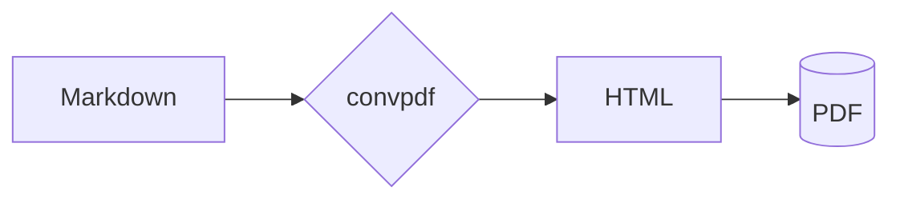
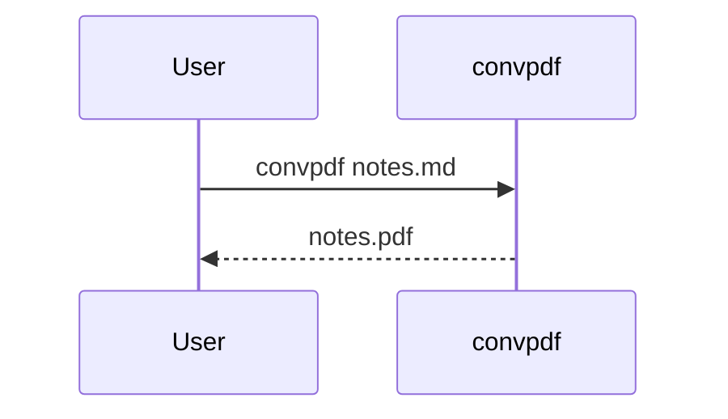
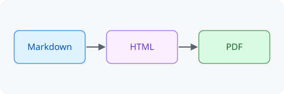

This document exercises every Markdown feature convpdf supports: CommonMark, GitHub Flavored Markdown and Obsidian syntax. Convert it with `convpdf examples/showcase.md --toc`.

## Text formatting

Plain text with **bold**, *italic*, ***bold italic***, ~~strikethrough~~, `inline code`, ==highlighted text==, <kbd>Ctrl</kbd> + <kbd>C</kbd>, H<sub>2</sub>O and E = mc<sup>2</sup>. Emoji shortcodes work too :tada: :rocket: :white_check_mark:.

Autolinks like https://github.com and www.example.com, an [inline link](https://commonmark.org "CommonMark"), a [reference link][ref], and an email: hello@example.com.

[ref]: https://github.github.com/gfm/

This line ends with two spaces  
so it breaks here. A backslash works too\
like this.

Obsidian tags look like this: #project/alpha #reading-list. Comments are hidden: %%you can't see me%%(there was one just before this parenthesis).

## Headings

### Third level
#### Fourth level
##### Fifth level
###### Sixth level

## Lists

1. First ordered item
2. Second item
   - Nested unordered
   - Another one
     1. Deeply nested
3. Third item

- [x] Completed task
- [ ] Open task
- [/] In progress (Obsidian)
- [-] Cancelled (Obsidian)

Term
: Definition lists are supported too.

## Blockquotes and callouts

> A classic blockquote.
>
> > Nested quotes work as well.

> [!NOTE]
> GitHub alert: useful information users should know.

> [!TIP]
> Helpful advice for doing things better.

> [!IMPORTANT]
> Key information users need to know.

> [!WARNING]
> Urgent info that needs immediate attention.

> [!CAUTION]
> Advises about risks or negative outcomes.

> [!example] Obsidian callout with a *custom* title
> Callouts can contain **any** Markdown:
> - lists
> - `code`
>
> > [!question]- Nested and foldable
> > Foldable callouts are shown expanded in print.

> [!success] Title-only callout

## Code

```typescript title="greet.ts"
interface User {
  name: string;
  email?: string;
}

export function greet(user: User): string {
  // Template literals are highlighted
  return `Hello, ${user.name}!`;
}
```

```python
from dataclasses import dataclass

@dataclass
class Point:
    x: float
    y: float

    def norm(self) -> float:
        return (self.x ** 2 + self.y ** 2) ** 0.5
```

```diff
- const answer = 41;
+ const answer = 42;
```

```bash
convpdf notes/ -o pdf/ --theme serif --toc
```

    Indented code blocks work too.

## Tables

| Feature        | GitHub | Obsidian | convpdf |
| :------------- | :----: | :------: | ----: |
| Tables         |   ✓    |    ✓     |     ✓ |
| Task lists     |   ✓    |    ✓     |     ✓ |
| Callouts       |   ✓    |    ✓     |     ✓ |
| Wikilinks      |        |    ✓     |     ✓ |
| Math           |   ✓    |    ✓     |     ✓ |

## Math

Inline math like $e^{i\pi} + 1 = 0$ and GitHub's $`\sqrt{2}`$ syntax. Prices like $5 and $10 stay as text.

$$
\int_{-\infty}^{\infty} e^{-x^2}\,dx = \sqrt{\pi}
\qquad
\mathbf{A} = \begin{pmatrix} a & b \\ c & d \end{pmatrix}
$$

```math
\sum_{n=1}^{\infty} \frac{1}{n^2} = \frac{\pi^2}{6}
```

## Diagrams





## Images



Obsidian-style embed with a width: ![[diagram.svg|240]]

## Obsidian links and embeds

Wikilinks: [[Embedded Note]], [[Embedded Note|with an alias]], a heading in this document: [[#Tables]], and an unresolved [[Missing Note]].

![[Embedded Note#Details]]

## Footnotes

Here is a footnote reference[^1] and another one[^long]. Inline footnotes work too.^[This one was written inline.]

[^1]: A simple footnote.
[^long]: A longer footnote with **formatting** and `code`.

## HTML

<details>
<summary>Collapsible section</summary>

Details elements are expanded in the PDF, since a PDF can't be clicked open.

</details>

<p align="center">Centered with raw HTML.</p>

---

*[HTML]: HyperText Markup Language

The end. Abbreviation definitions like the one above are removed from the output.
